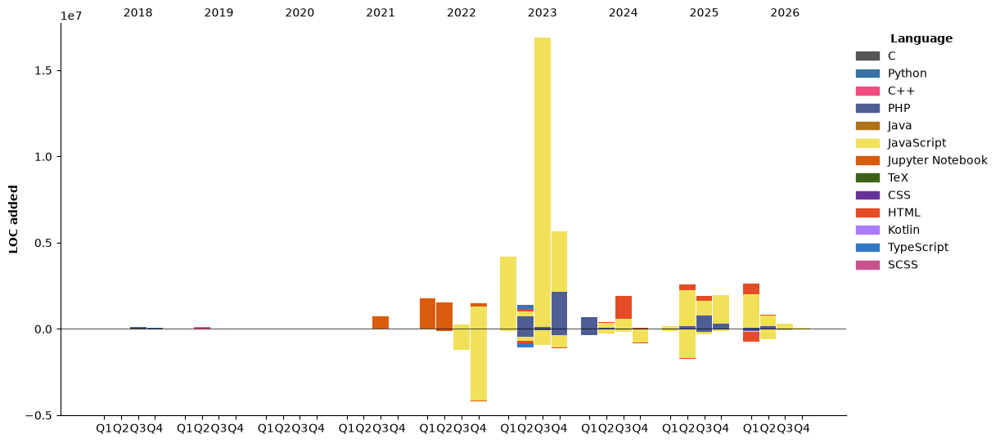

[](https://github.com/anuraghazra/github-readme-stats)


<!--START_SECTION:waka-->


**🐱 My GitHub Data** 

> 📦 1.1 MB Used in GitHub's Storage 
 > 
> 🏆 1,100 Contributions in the Year 2026
 > 
> 🚫 Not Opted to Hire
 > 
> 📜 12 Public Repositories 
 > 
> 🔑 5 Private Repositories 
 > 
**I'm an Early 🐤** 

```text
🌞 Morning                11471 commits       ██████░░░░░░░░░░░░░░░░░░░   23.86 % 
🌆 Daytime                28227 commits       ███████████████░░░░░░░░░░   58.71 % 
🌃 Evening                7299 commits        ████░░░░░░░░░░░░░░░░░░░░░   15.18 % 
🌙 Night                  1082 commits        █░░░░░░░░░░░░░░░░░░░░░░░░   02.25 % 
```
📅 **I'm Most Productive on Tuesday** 

```text
Monday                   10536 commits       █████░░░░░░░░░░░░░░░░░░░░   21.91 % 
Tuesday                  11483 commits       ██████░░░░░░░░░░░░░░░░░░░   23.88 % 
Wednesday                9166 commits        █████░░░░░░░░░░░░░░░░░░░░   19.06 % 
Thursday                 9726 commits        █████░░░░░░░░░░░░░░░░░░░░   20.23 % 
Friday                   6233 commits        ███░░░░░░░░░░░░░░░░░░░░░░   12.96 % 
Saturday                 807 commits         ░░░░░░░░░░░░░░░░░░░░░░░░░   01.68 % 
Sunday                   128 commits         ░░░░░░░░░░░░░░░░░░░░░░░░░   00.27 % 
```


📊 **This Week I Spent My Time On** 

```text
🕑︎ Time Zone: Europe/Moscow

💬 Programming Languages: 
PHP                      4 hrs 18 mins       ███████████░░░░░░░░░░░░░░   42.76 % 
JavaScript               2 hrs 27 mins       ██████░░░░░░░░░░░░░░░░░░░   24.38 % 
Smarty                   1 hr 37 mins        ████░░░░░░░░░░░░░░░░░░░░░   16.08 % 
Other                    36 mins             ██░░░░░░░░░░░░░░░░░░░░░░░   06.12 % 
JSON                     20 mins             █░░░░░░░░░░░░░░░░░░░░░░░░   03.32 % 

🔥 Editors: 
PhpStorm                 10 hrs 3 mins       █████████████████████████   100.00 % 

🐱‍💻 Projects: 
ci-market                4 hrs 20 mins       ███████████░░░░░░░░░░░░░░   43.21 % 
cms                      2 hrs 7 mins        █████░░░░░░░░░░░░░░░░░░░░   21.14 % 
yusupova-tf              1 hr 14 mins        ███░░░░░░░░░░░░░░░░░░░░░░   12.30 % 
osteodental              46 mins             ██░░░░░░░░░░░░░░░░░░░░░░░   07.66 % 
authorsport              45 mins             ██░░░░░░░░░░░░░░░░░░░░░░░   07.52 % 

💻 Operating System: 
Windows                  10 hrs 3 mins       █████████████████████████   100.00 % 
```

🤖 **AI Coding This Week** 

```text
⏱ AI Coding Time: 5 hrs 6 mins (50.82%)

✍️ 426 lines written by AI, 1,643 lines written by hand (20.59% AI-written)

🔤 2,063,713 Input Tokens, 160,174 Output Tokens

💵 $93.93 Estimated AI Cost This Week

🧠 8 AI Sessions, 37 AI Prompts

GLM                      491 lines           █████████████████████████   100.00 % 

🔎 AI Coding Insights:
🧑‍💻 Mostly Hands-On — 20.59% of written lines came from AI
📚 Verbose Prompter — average 34,941 characters per prompt
🔁 Iterative Prompter — average 5 prompts per session
🔍 Hands-On Reviewer — 75.22% of changed lines were hand-edited
```

**I Mostly Code in JavaScript** 

```text
JavaScript               31 repos            █████████░░░░░░░░░░░░░░░░   35.23 % 
HTML                     28 repos            ████████░░░░░░░░░░░░░░░░░   31.82 % 
PHP                      14 repos            ████░░░░░░░░░░░░░░░░░░░░░   15.91 % 
Python                   4 repos             █░░░░░░░░░░░░░░░░░░░░░░░░   04.55 % 
TypeScript               1 repo              ░░░░░░░░░░░░░░░░░░░░░░░░░   01.14 % 
```


**Timeline**




 Last Updated on 31/10/2026 22:07:48 UTC
<!--END_SECTION:waka-->


